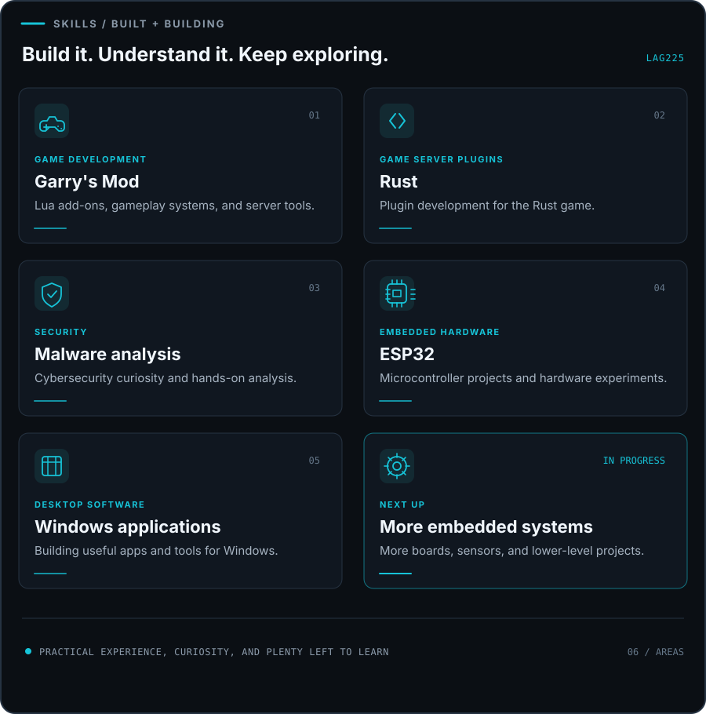

  

  

  
  
  
  

  
  
  

<h2 align="center">About</h2>

  Founder of <a href="https://zerosrp.co.uk"><strong>Zeros Host</strong></a>, a UK-run game server hosting company.
   
  I build the hosting, the custom control panel, and the tools that sit around it.
   
  Also involved with <a href="https://github.com/Blackfire-Interactive"><strong>Blackfire Interactive</strong></a>.

<table align="center">
  <tr>
    <td align="center" width="25%"><b>Hosting</b> Game servers, run in the UK</td>
    <td align="center" width="25%"><b>Control panel</b> Custom built, end to end</td>
    <td align="center" width="25%"><b>Mod manager</b> Install and manage mods</td>
    <td align="center" width="25%"><b>Backups and security</b> Tools to keep servers safe</td>
  </tr>
</table>

<h2 align="center">Projects</h2>

<table align="center">
  <tr>
    <td align="center" valign="top" width="50%">
      
        
      UK-run game server hosting with a custom panel, mod manager, backups, and security tools.
    </td>
    <td align="center" valign="top" width="50%">
      
        
      A Garry's Mod gangs addon with safer SQL string handling.
    </td>
  </tr>
  <tr>
    <td align="center" valign="top" width="50%">
      
        
      A fork exploring Jolt physics for the Source engine.
    </td>
    <td align="center" valign="top" width="50%">
      
        
      A small web project.
    </td>
  </tr>
</table>

  
  

<h2 align="center">Skills and interests</h2>

  Hands-on projects across game development, security, desktop software, and hardware.
   
  I have more embedded systems work on my list and want to keep building in that space.

  

<h2 align="center">Languages</h2>

  

<h2 align="center">GitHub activity</h2>

  
  

  

  

<h2 align="center">Meet the Blackfire Interactive team</h2>

  <a href="https://github.com/Blackfire-Interactive"><strong>Blackfire Interactive</strong></a>
   
  A small indie development team based in Scotland.

<table align="center">
  <tr>
    <td align="center" width="33%">
      
       
      <strong><a href="https://github.com/lag225">LAG</a></strong>
       
      Founder of Zeros Host
       
      <a href="https://github.com/lag225">That's me ↗</a>
    </td>
    <td align="center" width="33%">
      
       
      <strong><a href="https://github.com/Blackfire-IamaPineapple24">Jack</a></strong>
       
      Founder of Blackfire Interactive
       
      <a href="https://github.com/Blackfire-IamaPineapple24">Go check out his profile ↗</a>
    </td>
    <td align="center" width="33%">
      
       
      <strong><a href="https://github.com/Blackfire-ellobandeto">Callum</a></strong>
       
      Blackfire Interactive
       
      <a href="https://github.com/Blackfire-ellobandeto">Visit his profile ↗</a>
    </td>
  </tr>
</table>

  

